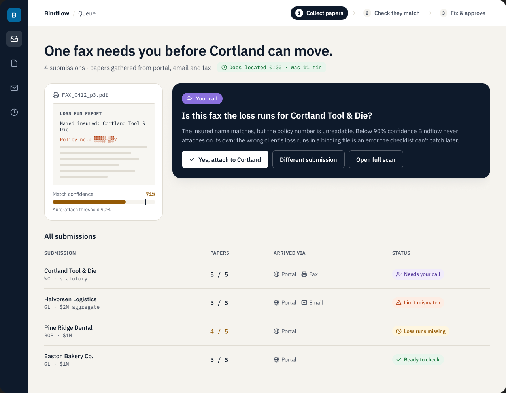
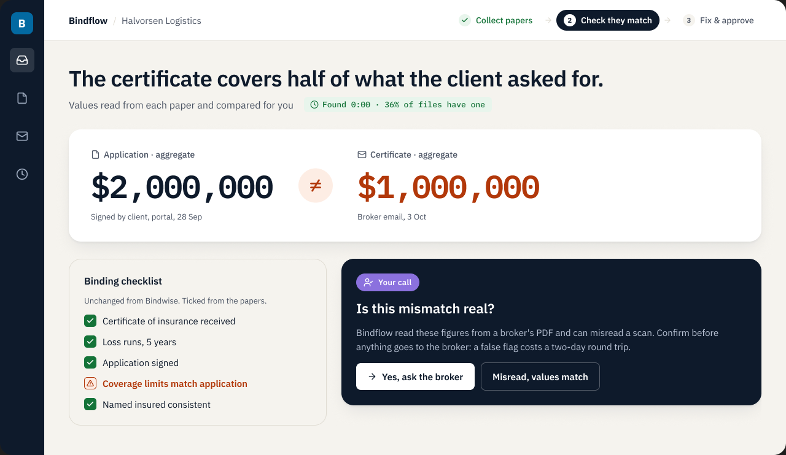
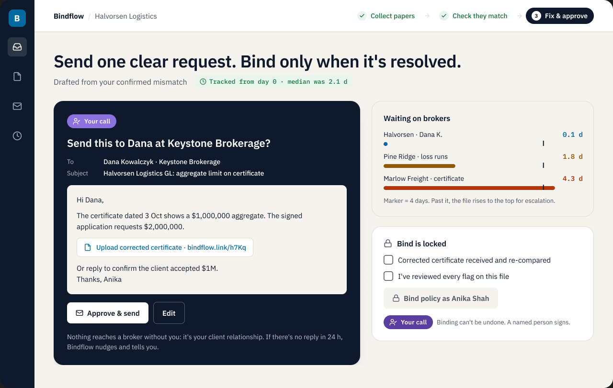

# Bindflow: Marsh & Colby underwriting

This is my submission for the [Ajaia](https://ajaia.ai) Design Lead assessment, by Arerosuoghene Omujale ([ofego.design](https://ofego.design)).

**The brief:** Owen, the client sponsor, asked for a faster, better-looking checklist. The interviews and usage logs show the checklist isn't where the time goes.

- Colin finishes the checklist in **3 minutes**, but spends **11 minutes** finding the documents.
- About **36%** of submissions have a coverage-limit mismatch.
- After a mismatch is flagged, the broker takes a median of **2.1 days** to reply.

Bindflow is designed around those three findings. AI does the slow, mechanical work: reading documents, matching them, drafting and chasing. A person makes every decision with consequences. Those decisions are marked in the designs with a purple **"Your call"** badge.

- **Final designs (Figma):** https://www.figma.com/design/6xILGqurhKPLRyw19t8xMH/Gostride?node-id=31-2. Each screen has notes explaining the design thinking.
- **Written submission:** [SUBMISSION.md](SUBMISSION.md). It covers the synthesis, the next interview questions, the design and the AI workflow note.
- **Early clickable prototype:** [prototype/](prototype/index.html). It shows the same flow and checkpoints in an earlier visual style.
- **Video:** link in SUBMISSION.md.

## 1 · Collect papers
Papers from the client portal, email and fax are gathered automatically. When Bindflow is unsure which submission a document belongs to, it asks a person instead of guessing.

## 2 · Check they match
The checklist assistants already know stays the same. Bindflow reads the figures from each document and shows any mismatch in large type. A person confirms the mismatch is real before the broker is contacted.

## 3 · Fix & approve
Bindflow drafts one clear request to the broker, and a person approves it before it's sent. It then tracks how long each broker has been waiting. Binding stays locked until a named person signs it off.

